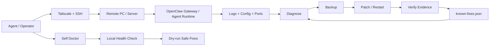

# 🩺 Doctor Tieu Tam

[](https://github.com/NachaFromMars/doctor-tieu-tam/actions/workflows/ci.yml)
[](https://github.com/NachaFromMars/doctor-tieu-tam/releases)
[](LICENSE)

> **Self & remote doctor for AI agents** — diagnose, heal, verify, and learn across local machines and remote PCs over Tailscale/SSH.

When an agent breaks, Doctor Tieu Tam helps it do what a good technician would do:
**check the patient, find the real cause, back up before touching anything, apply the smallest safe fix, verify with evidence, and remember the cure.**

---

## Why this matters

AI agents are becoming long-running workers: they manage chats, code, tasks, models, proxies, browser sessions, GitHub repos, and remote machines. When something fails, the usual answer is still: “wake up the human.”

Doctor Tieu Tam is built for the next step: **agents that can safely repair themselves and other agents.**

- Bot selected Claude/Qwen but still hits a Codex usage limit? → fix runtime/provider config.
- Gateway is running but the service state looks inactive? → verify by ports and health probes, not assumptions.
- Remote PC is online but the agent is silent? → connect through Tailscale/SSH, inspect logs/config, restart safely.
- Local host looks sick? → run `self_doctor.py` in dry-run first, then apply only safe fixes.

---

## Who is this for?

Doctor Tieu Tam currently focuses on **OpenClaw agents**, but the pattern fits many agent runtimes:

| Agent / runtime | What Doctor can help with |
|---|---|
| **OpenClaw** | gateway health, model/provider/runtime config, Telegram bot instances, local self-check |
| **Codex-style harnesses** | “selected non-Codex model but still runs Codex” runtime mismatch diagnosis |
| **Claude / OpenAI API proxies** | port/proxy health, `/health`, `/v1/models`, chat completion verification |
| **GitHub automation agents** | repo/push workflow checks, token redaction patterns, release/issue workflows |
| **Any SSH-reachable PC/server** | OS detection, CPU/RAM/disk, port checks, remote command evidence |

It is not a medical app. It is a **remote ops doctor for AI agent infrastructure**.

---

## Architecture



---

## What it can heal today

✅ Remote OpenClaw runtime mismatch (`/model` says Claude, but runtime still uses Codex)
✅ Gateway task/service state checks on Windows/Linux
✅ Port evidence checks (`18789`, `20128`, `20131`)
✅ Proxy/API health checks (`/health`, model/API reachability)
✅ Config JSON backup + safe patching
✅ Local self-check/self-heal dry-run
✅ Known-fix matching with regex/confidence/risk metadata
✅ Secret redaction and heal audit log

Planned for v1.0:
- Redacted diff before every config patch
- Rollback commands for each heal
- Tailscale SSH ACL-first mode
- Integration with `openclaw doctor --lint/--fix/--deep`
- Mock SSH integration tests
- Fleet registry for many machines

---

## Safety model

This project is intentionally conservative.

1. 🔒 **No unauthorized login** — remote access only works after the machine owner installs an SSH key.
2. 💾 **Backup before write** — config changes create `*.bak-tt-<timestamp>` backups.
3. 🧩 **Read → patch → write** — no blind file clobbering.
4. 🧪 **Verify with evidence** — service state, port listeners, HTTP probes, logs.
5. 🤐 **Secret redaction** — tokens, cookies, API keys, auth headers, private keys are redacted.
6. 📝 **Audit log** — heal operations are written to `doctor-audit.jsonl`.
7. 🚨 **Escalate on risk** — credentials, data loss, repeated failure, or high-risk fixes require a human.

> An agent that can fix machines is powerful. An agent that knows when **not** to act is trustworthy.

---

## 5-minute quickstart

### 1) Create a doctor key

```bash
ssh-keygen -t ed25519 -N '' -C 'doctor-tieu-tam' -f ~/.ssh/doctor_tt
cat ~/.ssh/doctor_tt.pub
```

Install the public key on the remote machine.

### 2) Check connection

```bash
python3 scripts/doctor.py connect-test --target user@host --key ~/.ssh/doctor_tt
```

### 3) Run health + verify

```bash
python3 scripts/doctor.py health --target user@host --key ~/.ssh/doctor_tt
python3 scripts/doctor.py verify --target user@host --key ~/.ssh/doctor_tt
```

### 4) Heal an OpenClaw runtime mismatch

```bash
python3 scripts/openclaw_heal.py set-runtime --target user@host \
  --provider claudekkg --runtime openclaw --key ~/.ssh/doctor_tt

python3 scripts/openclaw_heal.py restart --target user@host --key ~/.ssh/doctor_tt
```

### 5) Run local self-doctor

```bash
python3 scripts/self_doctor.py selfcheck
python3 scripts/self_doctor.py selfheal          # dry-run by default
python3 scripts/self_doctor.py selfheal --apply  # only safe fixes
```

---

## Real-world example

A remote Windows PC ran an AI bot that showed the correct model:

```text
claudekkg/cc/claude-opus-4-8
```

…but every message still failed with:

```text
You've reached your Codex subscription usage limit
```

Diagnosis: model selection changed, but the runtime still used the Codex harness.

Doctor Tieu Tam:
1. connected via Tailscale/SSH,
2. backed up `openclaw.json`,
3. patched `agentRuntime.id = "openclaw"` for the provider and model entries,
4. restarted the gateway,
5. verified the remote PC sent a real `/v1/chat/completions` request to the Claude proxy.

That case became a known fix.

See [`examples/runtime-mismatch.md`](examples/runtime-mismatch.md).

---

## Files

- `SKILL.md` — OpenClaw skill workflow + safety rules
- `scripts/doctor.py` — connect-test / scan / health / verify / known-fixes
- `scripts/openclaw_heal.py` — remote config backup / patch / restart / audit log
- `scripts/self_doctor.py` — local self-check and self-heal dry-run/apply
- `references/openclaw-playbook.md` — common OpenClaw heal cases
- `references/error-patterns.md` — pattern → root cause → fix
- `examples/` — real usage examples

---

## Install as an OpenClaw skill

Drop this folder into your OpenClaw `skills/` directory. OpenClaw will load `SKILL.md`.

---

## License

MIT — free to use, fork, improve, and share.

If this saves one late-night debugging session, a ⭐ helps others find it too. 🙏

## Doctor Immune System 🧬

Every successful heal can become an **antibody**: a reusable, scored known-fix that helps the next agent recover faster.

```bash
# Record a cured incident
python3 scripts/immune.py record-incident \
  --symptom "Claude model selected but Codex usage limit appears" \
  --cause "Runtime remained Codex harness" \
  --fix "Set agentRuntime.id=openclaw and restart gateway" \
  --verify "Proxy receives POST /v1/chat/completions;;Bot replies through Claude" \
  --risk low

# Learn an antibody from that incident
python3 scripts/immune.py learn --incident inc-xxxx --confidence 0.85 --risk low

# Match later symptoms
python3 scripts/immune.py match --symptom "Codex usage limit after selecting Claude"

# Propose / dry-run a known fix
python3 scripts/immune.py apply-known-fix --symptom "Codex usage limit after selecting Claude" --dry-run
```

The loop is:

```text
Fix → Verify → Record Incident → Learn Antibody → Add Test/Example → Release
```

This turns Doctor Tieu Tam from a one-off repair kit into a learning immune system for agent fleets.

## v0.5 — Simple outside, safe inside

Doctor Tieu Tam now keeps the UI simple while the immune engine becomes stricter internally.

**Simple operator loop:**

```text
Check → Heal → Verify → Learn
```

**Inside the immune engine:**

- Incidents are stored as richer patient records.
- Antibodies are split into `candidate/`, `trusted/`, and `deprecated/`.
- Vaccines live in `immune-system/vaccines/fleet_checks/` for future fleet scans.
- Confidence combines pattern match, evidence signals, history, and environment.
- Risk gate is enforced:
  - Low risk + trusted + verify plan + rollback plan + high confidence → auto-eligible
  - Medium risk → dry-run + ask
  - High risk → diagnose only
  - **No rollback = no auto-heal**

```bash
python3 scripts/immune.py match --symptom "Codex usage limit after selecting Claude"
python3 scripts/immune.py apply-known-fix --symptom "Codex usage limit after selecting Claude" --dry-run
python3 scripts/immune.py antibodies-promote --id ab_openclaw_runtime_mismatch_codex_limit --status trusted --force
python3 scripts/immune.py vaccinate-fleet --fleet fleet.json --antibody ab_openclaw_runtime_mismatch_codex_limit --dry-run
```
